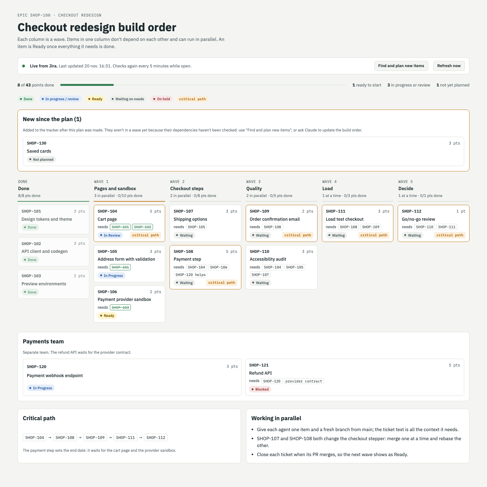
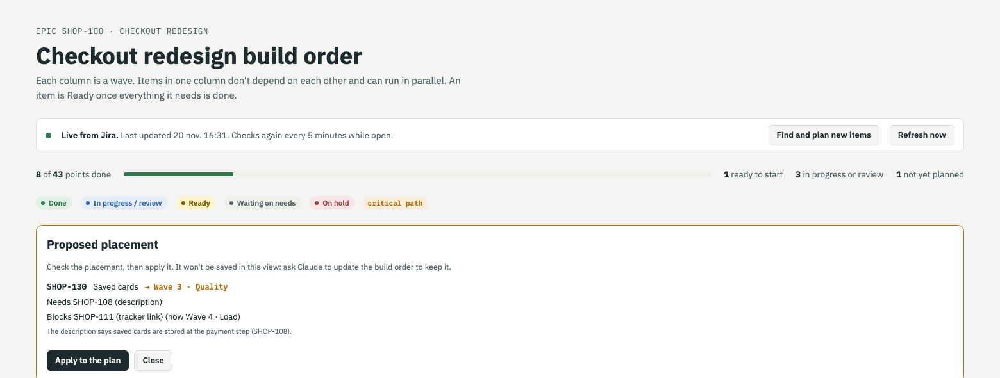

# claude-skills

Skills for [Claude Code](https://claude.com/claude-code).

## build-order

Turns an epic, milestone or sprint in **Azure DevOps, Jira or GitHub** into a live build-order page:
which items can run in parallel, what waits for what, and the chain of work that sets the end date.
The page reads status from your tracker while it's open, so it stays current as work moves.

<picture>
  <source media="(prefers-color-scheme: dark)" srcset="docs/build-order-dark.png">
  
</picture>

<sub>Screenshot with example data.</sub>

### What the page shows

- **Waves.** Each column is a wave. Items in one column don't depend on each other, so you can hand
  them to different people or agents at the same time.
- **Status per item**, read live from the tracker: Done, In progress or review, **Ready** (everything
  it needs is done), Waiting, On hold.
- **Dependencies** on every card. A need that's already done is struck through, a dashed one is
  helpful but not required, and a blocker outside the tracker shows as plain text.
- **Side lanes** for separate tracks: another team, an external blocker, a different stream.
- **The critical path**: the longest open chain, weighted by points.
- **Tips for working in parallel** that you write for the project, such as which items will conflict.
- **New items.** Tickets added to the scope after the page was made show up by themselves, in a
  "New since the plan" panel.

### Find and plan new items

The button in the status bar places new tickets for you. It reads each new ticket's dependency links.
Claude reads its description for "depends on" and "blocks" wording. The page then proposes a wave, with
the source of each dependency. Nothing changes until you press **Apply**.



### How you use it

Ask Claude Code in a project that uses one of the trackers, for example:

> In what order should we build the stories under epic 1234? Which ones can run in parallel?

> Make a build-order page for the "Checkout v2" milestone.

Claude then:

1. **Finds the tracker and the scope** from the repo and the tools you have connected.
2. **Builds the dependency graph.** Tracker links come first, then "Depends on" / "Blocked by" text.
3. **Shows you the plan in chat to confirm.** A wrong dependency makes the page confidently wrong.
4. **Publishes the page** as a private artifact and keeps its working files in
   `~/.claude/build-order/<project>/`, so a later session updates the same page.

### Install

Copy the skill into your personal skills folder:

```sh
git clone https://github.com/johan-lindahl/claude-skills
cp -R claude-skills/skills/build-order ~/.claude/skills/
```

### Requirements

- **Claude Code**, with permission to publish artifacts.
- **For the first plan**, read access to the tracker: the `az`, `jira` or `gh` CLI, or an MCP server
  for it.
- **For live status and planning on the page**, a connection the page can call:
  - a claude.ai connector for the tracker, which works in any browser; or
  - a local MCP server added to the Claude desktop app, which works only in the desktop app.

  Without a connection the page still works, as a snapshot from when it was published.

### Files

| Path | What it does |
|---|---|
| `skills/build-order/SKILL.md` | The workflow Claude follows |
| `skills/build-order/scripts/plan.py` | Waves, lanes and critical path from an items file. Stops on a dependency cycle |
| `skills/build-order/scripts/render.py` | Fills the page template with the plan and settings |
| `skills/build-order/assets/template.html` | The page, including live status and planning |
| `skills/build-order/references/` | How to read items, links and states from ADO, Jira and GitHub |
